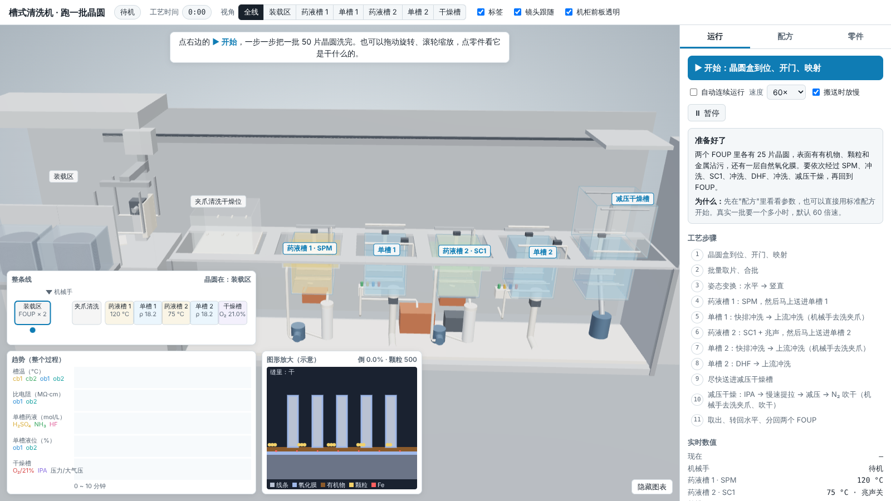
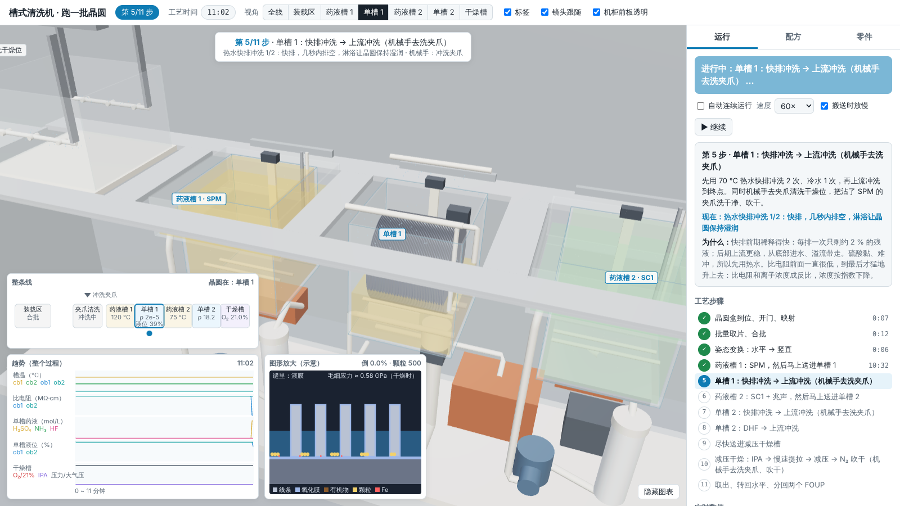
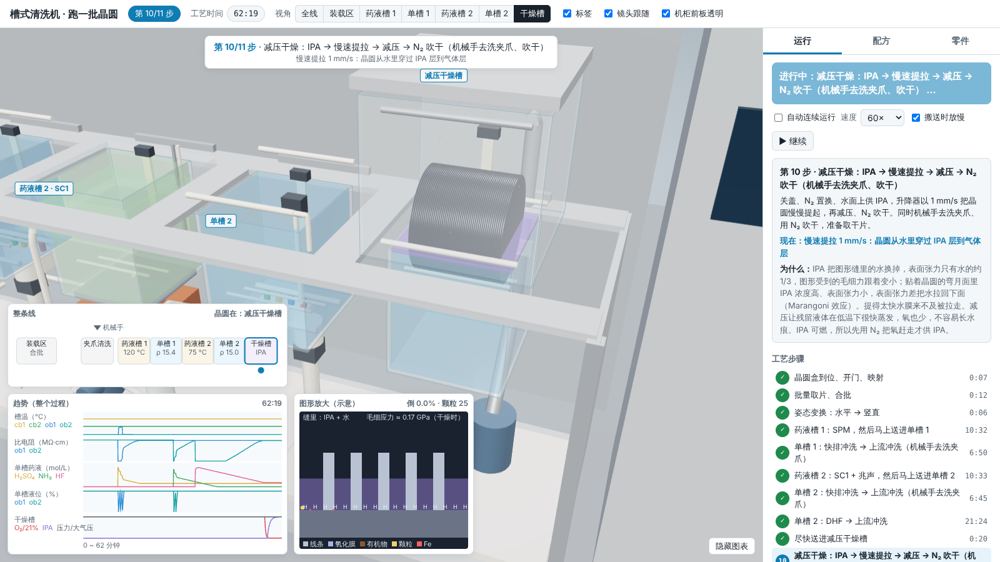
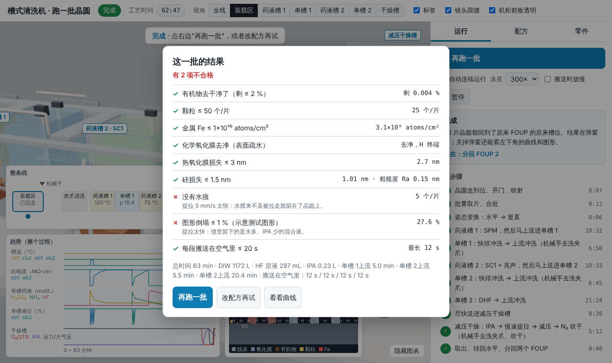

# 槽式清洗机教学演示 · 跑一批晶圆

一台**原创**的 300 mm 槽式湿法清洗机，给新人培训用。整机由三种槽组成一条线：

- **高温药液槽**（Chemical Bath）：高浓度、高温药液，一槽一种药，循环、过滤、保温
- **单槽**（One-Bath）：低浓度药液处理和纯水上流冲洗，同一个槽里可以换多种药
- **减压干燥槽**（Low-Pressure Dryer）：从水里经 IPA 层提出晶圆，减压、N₂ 吹干，防止图形倒塌

在网页里操作机台，让一批 50 片晶圆走完整条线，每一步都说明在干什么、为什么。不对应任何厂家的具体型号。
完整的计划见 [搭建路线.md](搭建路线.md)；这一版对应路线里的阶段 1（"能跑完一批"的简化版）。



| 单槽快排冲洗 | 减压干燥：晶圆穿过 IPA 层 | 结果 |
|---|---|---|
|  |  |  |

## 用法

双击 `启动.bat`（会先 `git pull` 检查 main 的更新），或者直接双击 `output\槽式清洗机_离线版.html`。不用联网，不用装任何东西。
电脑比较卡的话，在浏览器地址末尾加上 `?lite`（关掉阴影、降低分辨率）。

- **运行**页：点"▶ 下一步"一步一步跑 11 步；勾"自动连续运行"就自己跑完。速度 1× ~ 300×（真实一批约 68 分钟），"搬送时放慢"打开时，机械手和升降器在动的时候最多 5×，方便看清交接。每一步都写了"现在在干什么"和"为什么"。
- **配方**页：改每个槽的配比、温度、时间、快排次数、淋浴、冲洗终点、DHF 稀释比和注入时间、IPA、提拉速度、减压、搬送耽误的时间。下面实时显示"按这个配方跑一遍"的结果。
  预置了 8 个"错误配方"（SC1 太浓太热、不开兆声、DHF 太久、冲洗不够就走、快排不开淋浴、搬得太慢、提拉太快、不用 IPA），跑一下就知道各自出什么问题。
- **零件**页：点零件名或直接点 3D 模型里的零件，看它是干什么的。顶栏可以切换机柜前板透明 / 不透明。
- 左下角三个面板：
  - **整条线**：晶圆在哪、机械手在干什么、各槽的温度 / 比电阻 / 氧浓度，搬送时在空气里待了几秒
  - **趋势**：槽温、单槽比电阻、单槽药液浓度、液位、干燥槽的氧 / IPA / 压力
  - **图形放大**（示意）：氧化膜、有机物、颗粒、Fe、H 终端、缝里是什么液体、毛细应力多大、线条倒没倒
- 跑完弹出 9 项结果：有机物、颗粒、Fe、化学氧化膜、热氧化膜损失、硅损失、水痕、图形倒塌、搬送时的空气暴露。不合格的会说原因。

## 一批晶圆的流程

| # | 步骤 |
|---|---|
| 1 | 两个 FOUP 到装载口，开门，映射 |
| 2 | 批量机械手一次取 25 片，两盒交错合成 50 片（10 mm → 5 mm） |
| 3 | 姿态变换：水平 → 竖直 |
| 4 | 药液槽 1：SPM；提起来马上送进单槽 1 |
| 5 | 单槽 1：热水快排 → 冷水快排 → 上流冲洗（同时机械手去洗夹爪） |
| 6 | 药液槽 2：SC1 + 兆声；提起来马上送进单槽 2 |
| 7 | 单槽 2：快排 → 上流冲洗（同时机械手去洗夹爪） |
| 8 | 单槽 2：DHF（满槽注药）→ 上流冲洗 |
| 9 | 尽快送进减压干燥槽 |
| 10 | 关盖、N₂ 置换、供 IPA、慢速提拉、减压、N₂ 吹干（同时机械手去洗夹爪、吹干） |
| 11 | 取出干片、转回水平、分回两个 FOUP（每片回到原来的槽位） |

槽间搬送机械手只有一台，在槽之间水平移动；每个槽有自己的升降器，只在槽内上下。

## 模型（简化：趋势对、数量级对，系数是估计值）

| 内容 | 怎么算 | 可信度 |
|---|---|---|
| 比电阻 | 按电荷平衡解出 [H⁺]，再把各离子的电导加起来；25 °C 纯水 18.18 MΩ·cm | 公认 |
| 单槽 | 完全混合槽：满槽注药时浓度按 1 − e^(−t/τ) 爬升；快排每次留下约 2 % 的残液（按液膜排液公式推算）；淋浴冲稀残液 | 理想模型公认，系数估计 |
| 刻蚀量 | 速率 × 时间的积分。速率和浓度成正比时，满槽注药的刻蚀量只由"注入浓度 × 注入时间"决定，和槽的大小、流量无关 | 推导公认，系数估计 |
| HF 刻氧化膜 | 低浓度段速率和 HF 浓度近似成正比；10:1 HF 刻热氧化膜约 23 nm/min（待核对） | 趋势公认 |
| SPM / SC1 | SPM 去有机物；SC1 刻掉一点硅把颗粒掏松，兆声把小颗粒冲走，同时让 Fe 沉积；DHF 溶掉氧化膜时带走 Fe | 趋势公认，系数估计 |
| 干燥 | IPA 层越浓，Marangoni 能拉走水膜的临界提拉速度越高；提得快就留水膜 → 水痕；缝里留下的液体越接近 IPA，毛细应力越小 | 机理公认，参数估计 |
| 图形倒塌 | σ = (6γcosθ / D)(H/W)²，测试图形和倒塌阈值是原创示意 | 形式公认 |
| 空气暴露 | 按机械手、升降器的速度推算，每段搬送约 12 s | 估计 |

还没做（阶段 3、4）：药液槽的老化和补液、比电阻的温度影响、批内上下差和死区、联锁和报警、故障注入。
每个数值的出处和可信度见 [docs/资料来源.md](docs/资料来源.md)，规格见 [docs/规格.md](docs/规格.md)。

## 改代码

| 位置 | 内容 |
|---|---|
| `sim/` | 工艺和设备模型，纯 JS，不碰界面：`params.js`（参数）、`chem.js`（pH / 电导 / 比电阻）、`onebath.js`（单槽）、`chembath.js`（药液槽）、`dryer.js`（减压干燥槽）、`surface.js`（晶圆表面和图形倒塌）、`tool.js`（整机流程、交接联锁、夹爪清洗）、`recipe.js`（配方）、`result.js`（结果判定） |
| `sim/test/` | 单元测试：模型自洽检查、量级检查、整机、每个预置配方 |
| `web/index.html` + `web/app.js` | 网页源码（three.js 走 CDN，开发时用本地 http 服务器打开） |
| `tools/build_offline.mjs` | 打包成单文件离线版 |

```
npm install      # 第一次：装打包用的 esbuild 和 three
npm test         # 跑 sim/ 的单元测试
npm run build    # 生成 output/槽式清洗机_离线版.html
```

这个仓库是公开的，只用公开资料和通用原理，规则见 [CLAUDE.md](CLAUDE.md)。
