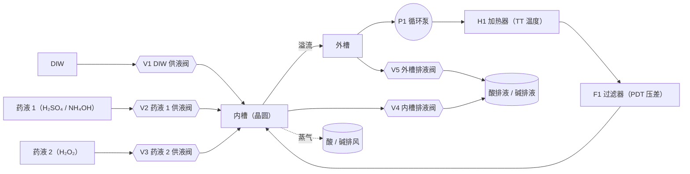
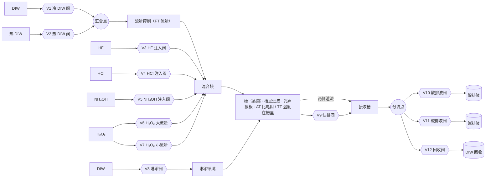
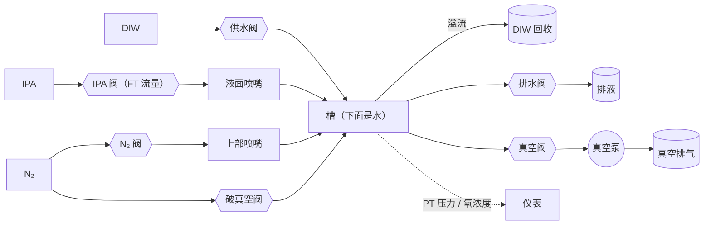
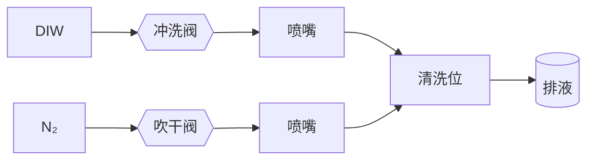

# 管路（功能块级初稿）

阶段 1 的管子只是摆样子的简模：没有阀门，没和模拟连，走向也是随手连的。这份文件定"管路怎么做"；药液槽、单槽已按作者的概要图做完（第 3、4 节）。

已定（作者选的）：
- 先做**功能块级**（每个槽 5～12 个元件，只画主路径），结构确认后再加仪表和次要阀门
- 先做 **2D 管路图**，3D 管子随后按同一份数据重建
- 和模拟连到**流向**这一层：按阀门开关算出每段管有没有流、流的是什么、往哪流；不做水力计算（压力、流量、泵曲线）

公开边界：下面的结构都按公开专利和通用工程写。作者只需要指出"这里不合理"，不需要也不应该提供实际机台的管路。

---

## 1 · 做法：管路做成数据

一份拓扑数据（`sim/piping.js`），生成三样东西：

| 用途 | 怎么用这份数据 |
|---|---|
| 2D 管路图 | 每个元件带版面坐标；阀门、仪表用 ISA 5.1 的通用符号（公开标准）；开关状态、液体颜色、流向箭头实时显示 |
| 模拟 | 阀门开关 → 算出哪些管在流、流的是什么 → 高亮；联锁检查（阀门组合不允许时报出来） |
| 3D 管子 | 按同一份拓扑沿机柜里的走线通道走直角，再手调转折点 |

为什么这样做：同一份管路在三个地方用，各画一遍迟早对不上；化工行业有 DEXPI 这类"P&ID 即数据"的交换标准，这是公认的方向（我们不用它的格式，只借思路）。

### 1.1 数据长什么样

```js
// 节点：源（DIW、药液原液、N₂…）、出口（排液、排风、真空）、槽、阀、泵、加热器、过滤器、仪表、喷嘴、分支点
{ id: 'ob1.V_HF', kind: 'valve', label: 'HF 注入阀', tag: 'XV-12', at: [x, y] }
// 管段：从 a 流向 b，属于哪个系统（供液 / 循环 / 溢流 / 排液 / 气体 / 真空 / 排风）
{ id: 'ob1.p7', a: 'ob1.V_HF', b: 'ob1.MIX', sys: 'supply' }
```

每种槽一份模板（药液槽、单槽、减压干燥槽、夹爪清洗干燥位），按槽实例化（`cb1`、`cb2`、`ob1`、`ob2`、`dr`），再接到公共设施上。

### 1.2 流向怎么算

一段管在流，当且仅当它在一条"从推动者到接收者、中间阀门全开"的路径上：

- **推动者**：开着的供应源（DIW、药液、N₂ 有压力）、运行中的泵、底部排液阀开着的槽（靠重力）、正在被供液而溢流的槽
- **接收者**：槽、排液 / 排风 / 真空出口
- 算法：从推动者沿开着的阀门往下游走一遍，再从接收者往上游走一遍，两边都走到的管段就在流
- 流的是什么：从源头带过来（DIW、热 DIW、HF 稀释液……）；从槽里流出来的就是槽里的液体

这一层只回答"走哪条路"，不算压力和流量。流量还是由现在的单槽模型给出（`sim/onebath.js`）。

### 1.3 阀门开关从哪来

第一步：由现在的流程状态推出阀门开关（例如单槽在"快排"，就开快排阀和对应的排液分流阀）。
以后（阶段 4）：反过来，由流程发出"开阀 / 关阀"，槽里的液位和浓度根据流向来算。那时管路就是真正的控制对象，阀门卡住、过滤器堵这些故障可以直接作用在上面。

---

## 2 · 公共设施（全线共用，画在管路图边上当接口）

| 类别 | 内容 |
|---|---|
| 供应 | 冷 DIW、热 DIW、药液原液（H₂SO₄、H₂O₂、NH₄OH、HF、HCl）、IPA、N₂。热 DIW 从哪来（厂务供应还是设备里的热水单元）：待核对 |
| 出口 | 酸排液、碱排液、有机排液、DIW 回收；酸 / 碱 / 有机排风；真空排气 |

---

## 3 · 高温药液槽（`cb1` SPM、`cb2` SC1）· 已实现（样板）

作者给了概要图（2026-10-25）：供液（DIW、药液 1、药液 2）从上方进内槽；循环线 外槽 → 泵 → 加热器 → 过滤器 → 内槽底部，和公开专利一致。按这张图改了初稿（原来把供液画成进外槽），并做成样板：`sim/piping.js` 的数据 → 2D 管路图（顶栏"管路图"）+ 流向 + 3D 管子。



| 元件 | 作用 | 依据 |
|---|---|---|
| 内槽 → 外槽 | 内槽溢流到外槽，表面一直在更新 | [US8052833]、[US10928732] |
| 循环线：外槽 → 泵 → 加热器 → 过滤器 → 内槽底部 | 一直在循环、保温、过滤 | [US8052833]、[US10928732]（两份都是这个顺序；也有在泵前加脱气过滤的） |
| 供液阀 V1～V3：DIW、药液 1、药液 2 → 内槽上方 | 建浴、稀释、按浓度补液（例如 H₂O₂ 分解后补，阶段 3） | 作者的概要图；通用做法 |
| 排液阀 V4（内槽）、V5（外槽） | 换液时排掉旧液 | 通用做法；热药液排之前要不要先冷却：待核对 |
| 仪表 | 温度（TT）、外槽液位（LT）、过滤器压差（PDT） | 通用做法；浓度计装在哪：待核对 |

阀门开关：
- 跑批时：泵和加热器一直开，供液阀、排液阀关（药液槽当恒定处理）
- 换液（演示，管路图里的"换液"按钮，没在跑批时才能做）：停加热器和泵 → 开 V4、V5 排液 → 依次开 V1、V2、V3 补液（内槽先满，再溢流到外槽）→ 外槽液位够了开泵 → 开加热器升温
- 联锁（在药液槽模型里强制，管路数据再检查一遍）：外槽液位低于 30 % 泵停；泵停了加热器停
- 没建模的：SPM 混合时的放热（H₂O₂ 加进 H₂SO₄ 会明显升温 [Piranha-wiki]）、热药液排液冷却

---

## 4 · 单槽（`ob1`、`ob2`）· 已实现

作者给了两张概要图（2026-10-25，都是凭记忆画的），并确认了几点：槽底那块是兆声振板（在进液口旁边）；两路 H₂O₂ 是两个流量范围；比电阻计装在槽里。两张图大体一致，热水的接法不同：第一张是 DIW 经气体溶解单元、热 DIW 单元，在混合块下游并入；第二张是冷 / 热 DIW 先汇合，再一起过流量控制、进混合块。作者选了第二张（也是最通用的接法）。排液按第一张分三路（酸 / 碱 / DIW 回收），第二张只画了两路排液。

做法和药液槽样板一样：`sim/piping.js` 的 `oneBathTemplate` → 2D 管路图（顶栏"管路图" → 单槽 1 / 2）+ 流向 + 3D 管子。



| 元件 | 作用 | 依据 |
|---|---|---|
| 冷 DIW（V1）、热 DIW（V2）→ 汇合点 → 流量控制 | 上流冲洗、热水冲洗、快排后补水；进槽的总流量在这里控制 | 作者的第二张概要图；通用做法 |
| 流量控制 → 混合块 → 槽底进液 | 药液注进这股水里，从下往上进槽 | 作者的概要图；药液和 DIW 从槽下部进 [US9859109] |
| 注入阀 V3～V7 → 混合块 | 按比例把原液注进 DIW 流。槽里浓度 = 原液流量 ÷ 总流量 | 作者的概要图；一个单槽可以用多种药（作者确认） |
| H₂O₂ 两路：V6 大流量、V7 小流量 | 配比浓、稀相差很大，一个阀覆盖不了这么宽的流量范围 | 作者确认；分界 0.5 L/min 是估计（资料来源 D11） |
| 两侧溢流、侧面的快排阀 V9 → 接液槽 | 槽满后进多少溢多少；快排几秒内排空。接液槽进多少出多少，自己不存液 | 作者的概要图（两张都是共用接液槽、一根排液管）；内槽溢流到外槽再排走 [US8038798] |
| 接液槽 → 一根排液管 → 分流 V10～V12 | 按液体分到酸排液 / 碱排液 / DIW 回收，同时只开一路 | 作者的第一张概要图；作者选了三路；分流规则是原创（见 4.2） |
| 淋浴阀 V8 → 淋浴喷嘴 | 快排时保持晶圆湿润；快排后补水时喷到晶圆重新浸没 | 作者确认；两张图都是从 DIW 单独分出一路 |
| 比电阻计（AT）、温度计（TT）在槽里；供液流量（FT）在流量控制上 | 判冲洗终点 | 作者确认在槽里；公开先例 [US8043468]（也有装在溢流线上的 [US6001191]） |
| 兆声振板在槽底、进液口旁边 | 帮忙去小颗粒 | 作者确认；这一版的配方在单槽里不开 |

### 4.1 阀门开关（由单槽的状态推出来，`oneBathState`）

| 单槽在做什么 | 开着的阀 | 排液走哪 |
|---|---|---|
| 上流冲洗 | V1（热水冲洗是 V2） | 按槽里的液体（见 4.2） |
| 快排后补水 | V1 或 V2（开淋浴时 + V8，直到晶圆浸没） | 不排（槽没满，不溢流） |
| 满槽注药（例如 HF） | V1 + V3 | 注药一开始就切到注的药对应的那路（HF → V10），不等槽里浓度上来 |
| 快排 | V9（开淋浴时 + V8） | 按槽里的液体，但不进回收 |
| 静止 | 全关 | — |

### 4.2 排液分流（原创规则）

槽里的液体先按浓度和比电阻起个名字（`OneBath.fluid()`）：
- 主要的药 ≥ 1 mmol/L：叫药的名字（H₂SO₄、NH₄OH、HF …）
- 药 < 1 µmol/L，而且比电阻 ≥ 10 MΩ·cm：DIW（干净）
- 中间：冲洗水。主要是氨水叫"碱性冲洗水"，其余叫"酸性冲洗水"

分流：注药时按注的药切；不注药时，碱 → 碱排液，酸、冲洗水、H₂O₂ → 酸排液，干净的 DIW → 回收。回收另外有两条规则（作者选的）：
1. **快排永远不进回收**：快排一下子排 42 L（峰值约 500 L/min，估计），哪怕槽里已经是干净的水，也走酸排液
2. **干净以后还要再溢流 30 s 才切回收**（`P.reclaimDelayS`，估计）：快排和溢流共用接液槽和那根排液管，壁上、管里还挂着前面的脏水，先用干净的溢流水冲走

为什么快排和上流不会在"排液种类"上冲突：两者排的是同一槽液体；快排一开，液面马上掉到溢流口以下，溢流就停了，同一时刻只有一种。真正要防的是切换那一刻共用管路里的残液，就是第 2 条规则。

标准配方跑一批的样子（模拟结果，不是实测）：单槽 1 快排、上流前段排酸排液，比电阻到 10 MΩ·cm 后再溢流 30 s 切到回收；单槽 2 冲 SC1 时排碱排液，冲干净切回收；开始注 HF 的那一刻切到酸排液，冲到又干净了再切回收。

什么时候不准：残液只用"等一段时间"来处理，没有算接液槽和排液管的容积；配方里一般直接写"这一步排到哪"。这里按状态推导，是为了让新人看清"为什么这时候排到这里"。

### 4.3 联锁（`checkInterlocks`，测试里整批每 0.5 s 检查一次）

- 分流切错：酸碱进了回收、酸进了碱排液、碱进了酸排液
- 接液槽有液体进来（溢流或快排），但排液阀全关：会满出来
- 分流点同时开了两路
- 同一个单槽里，酸和碱的注入阀同时开
- 注药时冷 / 热 DIW 阀都没开：原液直接进槽，配比不对

没做的：
- 气体溶解单元（N₂ / O₃ 溶解水，第一张图里有，第二张没有；O₃ 溶解水在室温去有机物的公开出处 [Ohmi1993]）
- 流量控制的细节：第二张图里主路和淋浴都有并联的针阀，可能是阀关着时也留一点小流量、不让管子死水（推测，待作者确认趋势）
- 槽的层数：第二张图里槽外面还有一层，兆声画在它底下，可能是装水传声的外槽（推测）；这里只画了槽 + 接液槽
- 单槽的排风切换、冷热水同时开的温度混合、兆声在单槽里的使用

---

## 5 · 减压干燥槽（`dr`）



| 元件 | 作用 | 依据 |
|---|---|---|
| 供水 / 溢流 / 排水 | 槽里保持一槽干净的水 | 通用做法 |
| IPA 阀 → 液面喷嘴 | 在水面上形成 IPA 层 | 作者确认（水面上有一层 IPA）；公开专利里多是把晶圆提到 IPA 蒸气里 [US6354311] |
| N₂ 阀 → 上部喷嘴 | 置换氧、最后吹干 | 通用做法 |
| 真空阀 → 真空泵 | 减压干燥 | 减压泵抽槽 [US20070227032] |
| 破真空阀 | 用 N₂ 回到大气压 | 通用做法 |
| 仪表 | 压力（PT）、氧浓度 | 通用做法（IPA 可燃，供 IPA 前要确认氧够低） |

阀门开关（第一版，由干燥步骤推出来）：关盖 → N₂ 阀开 → IPA 阀开 → 慢速提拉 → IPA 阀关 → 真空阀开 → 真空阀关、破真空阀开 → N₂ 阀关。

---

## 6 · 夹爪清洗干燥位（`chuck`）



排液去哪（夹爪上沾的是药液，初稿接酸排液）：待核对。

---

## 7 · 联锁（用管路数据检查，阶段 4 正式做；这里先列通用的）

- ✅ 快排阀、溢流线开着时，排液分流必须已经切到和槽里液体对应的线路（酸不能进回收）
- ✅（只查了"有没有 DIW 在流"）注药时 DIW 流量必须在范围内，否则配比不对
- ✅ 药液槽循环泵停了，加热器必须停（防止空烧）
- 干燥槽：盖子没关不能开真空阀、不能开 IPA 阀；氧浓度没降下来不能开 IPA 阀
- ✅ 同一个单槽里，酸和碱的注入阀不能同时开

✅ = 已经用管路数据检查（`sim/piping.js` 的 `checkInterlocks`）。

---

## 8 · 实施步骤

| 步 | 做什么 | 验收 |
|---|---|---|
| 1 | 这份文档 | 作者看过，结构上没有明显不合理 |
| 2 | `sim/piping.js`：拓扑数据 + 流向计算 + 阀门开关推导 | 测试：标准流程每一步该流的管都流、不该流的不流；酸性液体从不流进回收；图里没有孤立的元件 |
| 3 | 2D 管路图：顶栏"管路图"按钮打开大面板，按槽切换，可以跟着晶圆走 | 截图审；开关、颜色、箭头和流程一致 |
| 4 | 3D 管子按同一份数据重建 | 截图审 |
| 5 | 细化：加仪表、次要阀门 | 作者指出要加的 |

进度：药液槽（样板）、单槽已完成第 2～4 步（`sim/test/piping.test.js` 12 个测试）；接下来按同样的做法做减压干燥槽、夹爪清洗干燥位。

预计 3～5 天，其中第 1 步最需要作者参与。

---

## 9 · 请作者看的（只说对不对）

1. ~~药液槽循环线的顺序~~：作者确认，和公开专利一致。
2. ~~单槽有没有溢流槽；比电阻计放在哪~~：作者的概要图有接液槽，比电阻计在槽里。
3. ~~排液分成哪几路~~：作者的概要图是酸 / 碱 / DIW 回收。
4. 热药液排液前要不要冷却。
5. 夹爪清洗的排液去哪。
6. 热 DIW 从哪来：厂务供应，还是设备里的热水单元；几个单槽共用还是各一套（现在画成公共设施的一个接口）。
7. ~~快排和上流的排液会不会冲突~~：不冲突（同一槽液体、不会同时发生）；作者选了三路排液 + 两条规则（快排不进回收、干净以后再溢流一会儿才切回收）。
8. 第二张概要图里主路、淋浴并联的针阀，是不是"阀关着也留一点小流量、防死水"（只问趋势）。

---

## 公开专利（只用公开文本，不写申请人）

| 编号 | 用在哪 |
|---|---|
| [US8052833](https://patents.google.com/patent/US8052833) | 内槽 / 外槽，循环线：泵 → 加热器 → 过滤器 → 内槽底部 |
| [US10928732](https://image-ppubs.uspto.gov/dirsearch-public/print/downloadPdf/10928732) | SPM 槽的循环线：泵 → 加热器 → 过滤器 |
| [US9859109](https://image-ppubs.uspto.gov/dirsearch-public/print/downloadPdf/9859109) | 药液和 DIW 从槽下部的喷嘴进 |
| [US8038798](https://patents.google.com/patent/US8038798) | 单槽里先药液后冲洗；内槽溢流到外槽再排走 |
| [US6001191](https://image-ppubs.uspto.gov/dirsearch-public/print/downloadPdf/6001191) | 比电阻计接在溢流线上，旁边有切换阀和排液线 |
| [US8043468](https://image-ppubs.uspto.gov/dirsearch-public/print/downloadPdf/8043468) | 比电阻计装在槽里 |
| [US5826601](https://image-ppubs.uspto.gov/dirsearch-public/print/downloadPdf/5826601) | 按排出水的比电阻结束最终冲洗 |
| [US6354311](https://patents.google.com/patent/US6354311) | 晶圆从 DIW 里提到含 IPA 的气氛中干燥 |
| [US20070227032](https://patents.justia.com/patent/20070227032) | 减压泵抽干燥腔 |

## 修订记录

- 2026-10-25：初稿（功能块级）
- 2026-10-25：药液槽按作者的概要图改（供液从上方进内槽）；循环线顺序作者确认；药液槽样板完成（数据、流向、2D 管路图、3D 管子、换液演示）
- 2026-10-25：单槽按作者的概要图重写并实现：冷 DIW 穿过混合块从下往上、热 DIW 在下游并入、两侧溢流和快排进接液槽、一根排液管分酸 / 碱 / 回收；兆声振板、两路 H₂O₂、槽里的比电阻计按作者确认；管路图加了跟着晶圆自动切换
- 2026-10-25：按作者的第二张概要图改热水：冷 / 热 DIW 先汇合，经流量控制进混合块（去掉气体溶解单元）；回收加两条规则：快排不进回收、干净以后再溢流 30 s 才切回收
