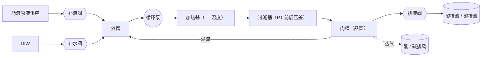
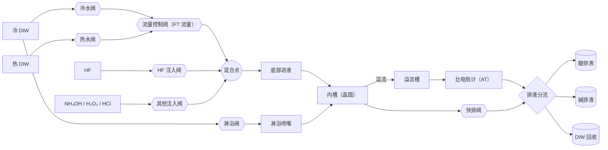
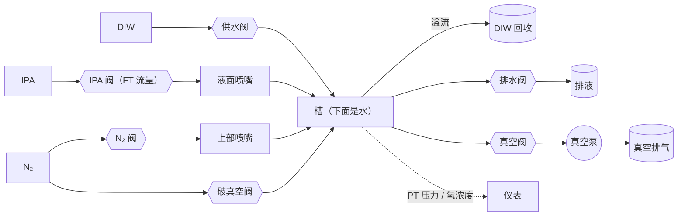
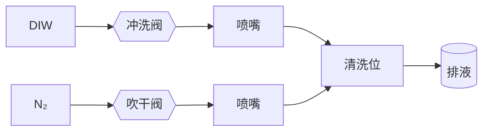

# 管路（功能块级初稿）

阶段 1 的管子只是摆样子的简模：没有阀门，没和模拟连，走向也是随手连的。这份文件定"管路怎么做"，作者审完再写代码。

已定（作者选的）：
- 先做**功能块级**（每个槽 5～12 个元件，只画主路径），结构确认后再加仪表和次要阀门
- 先做 **2D 管路图**，3D 管子随后按同一份数据重建
- 和模拟连到**流向**这一层：按阀门开关算出每段管有没有流、流的是什么、往哪流；不做水力计算（压力、流量、泵曲线）

公开边界：下面的结构都按公开专利和通用工程写。作者只需要指出"这里不合理"，不需要也不应该提供实际机台的管路。

---

## 1 · 做法：管路做成数据

一份拓扑数据（`sim/piping.js`），生成三样东西：

| 用途 | 怎么用这份数据 |
|---|---|
| 2D 管路图 | 每个元件带版面坐标；阀门、仪表用 ISA 5.1 的通用符号（公开标准）；开关状态、液体颜色、流向箭头实时显示 |
| 模拟 | 阀门开关 → 算出哪些管在流、流的是什么 → 高亮；联锁检查（阀门组合不允许时报出来） |
| 3D 管子 | 按同一份拓扑沿机柜里的走线通道走直角，再手调转折点 |

为什么这样做：同一份管路在三个地方用，各画一遍迟早对不上；化工行业有 DEXPI 这类"P&ID 即数据"的交换标准，这是公认的方向（我们不用它的格式，只借思路）。

### 1.1 数据长什么样

```js
// 节点：源（DIW、药液原液、N₂…）、出口（排液、排风、真空）、槽、阀、泵、加热器、过滤器、仪表、喷嘴、分支点
{ id: 'ob1.V_HF', kind: 'valve', label: 'HF 注入阀', tag: 'XV-12', at: [x, y] }
// 管段：从 a 流向 b，属于哪个系统（供液 / 循环 / 溢流 / 排液 / 气体 / 真空 / 排风）
{ id: 'ob1.p7', a: 'ob1.V_HF', b: 'ob1.MIX', sys: 'supply' }
```

每种槽一份模板（药液槽、单槽、减压干燥槽、夹爪清洗干燥位），按槽实例化（`cb1`、`cb2`、`ob1`、`ob2`、`dr`），再接到公共设施上。

### 1.2 流向怎么算

一段管在流，当且仅当它在一条"从推动者到接收者、中间阀门全开"的路径上：

- **推动者**：开着的供应源（DIW、药液、N₂ 有压力）、运行中的泵、底部排液阀开着的槽（靠重力）、正在被供液而溢流的槽
- **接收者**：槽、排液 / 排风 / 真空出口
- 算法：从推动者沿开着的阀门往下游走一遍，再从接收者往上游走一遍，两边都走到的管段就在流
- 流的是什么：从源头带过来（DIW、热 DIW、HF 稀释液……）；从槽里流出来的就是槽里的液体

这一层只回答"走哪条路"，不算压力和流量。流量还是由现在的单槽模型给出（`sim/onebath.js`）。

### 1.3 阀门开关从哪来

第一步：由现在的流程状态推出阀门开关（例如单槽在"快排"，就开快排阀和对应的排液分流阀）。
以后（阶段 4）：反过来，由流程发出"开阀 / 关阀"，槽里的液位和浓度根据流向来算。那时管路就是真正的控制对象，阀门卡住、过滤器堵这些故障可以直接作用在上面。

---

## 2 · 公共设施（全线共用，画在管路图边上当接口）

| 类别 | 内容 |
|---|---|
| 供应 | 冷 DIW、热 DIW（设备里的加热器出口）、药液原液（H₂SO₄、H₂O₂、NH₄OH、HF、HCl）、IPA、N₂ |
| 出口 | 酸排液、碱排液、有机排液、DIW 回收；酸 / 碱 / 有机排风；真空排气 |

---

## 3 · 高温药液槽（`cb1` SPM、`cb2` SC1）



| 元件 | 作用 | 依据 |
|---|---|---|
| 内槽 → 外槽 | 内槽溢流到外槽，表面一直在更新 | [US8052833]、[US10928732] |
| 循环线：外槽 → 泵 → 加热器 → 过滤器 → 内槽底部 | 一直在循环、保温、过滤 | [US8052833]、[US10928732]（两份都是这个顺序；也有在泵前加脱气过滤的） |
| 补液阀 | 建浴、按浓度补液（例如 H₂O₂ 分解后补） | 通用做法（阶段 3 才真正补液） |
| 补水阀 | 稀释、补蒸发掉的水 | 通用做法 |
| 排液阀 | 换液时排掉旧液 | 通用做法；热药液排之前要不要先冷却：待核对 |
| 仪表 | 温度（TT）、外槽液位（LT）、过滤器前后压力（PT） | 通用做法；浓度计装在哪：待核对 |

阀门开关（第一版）：泵和加热器一直开；补液、补水、排液阶段 1 不动（药液槽当恒定处理）。

---

## 4 · 单槽（`ob1`、`ob2`）



| 元件 | 作用 | 依据 |
|---|---|---|
| 冷 / 热 DIW → 流量控制阀 → 混合点 → 底部进液 | 上流冲洗；热水冲洗 | 药液和 DIW 从槽下部进 [US9859109] |
| 注入阀 → 混合点 | 按比例把原液注进 DIW 流（满槽注药） | 通用做法；一个单槽可以用多种药（作者确认） |
| 内槽 → 溢流槽 → 溢流线 | 槽满后进多少溢多少 | 内槽溢流到外槽再排走 [US8038798] |
| 比电阻计 | 判冲洗终点 | 装在溢流线上 [US6001191] 或槽里 [US8043468] 都有公开先例；初稿放在溢流线上（原创选择） |
| 快排阀 | 几秒内排空 | 通用做法 |
| 淋浴阀 → 淋浴喷嘴 | 快排时保持晶圆湿润，防图形倒塌 | 作者确认 |
| 排液分流 | 按槽里的液体分到酸 / 碱 / 回收（有机暂不用） | 通用做法；分流规则是原创：有酸 → 酸排，有碱 → 碱排，比电阻高于判定值 → 回收 |

阀门开关（第一版，由单槽的状态推出来）：

| 单槽在做什么 | 开着的阀 |
|---|---|
| 上流冲洗（冷 / 热） | 冷水阀或热水阀、流量控制阀；溢流线 → 排液分流 |
| 满槽注药（例如 HF） | 上面这些 + HF 注入阀 |
| 快排 | 快排阀（+ 淋浴阀，如果开淋浴）；排液分流 |
| 快排后补水 | 冷水阀或热水阀、流量控制阀（+ 淋浴阀，直到晶圆浸没） |
| 静止 | 全关 |

---

## 5 · 减压干燥槽（`dr`）



| 元件 | 作用 | 依据 |
|---|---|---|
| 供水 / 溢流 / 排水 | 槽里保持一槽干净的水 | 通用做法 |
| IPA 阀 → 液面喷嘴 | 在水面上形成 IPA 层 | 作者确认（水面上有一层 IPA）；公开专利里多是把晶圆提到 IPA 蒸气里 [US6354311] |
| N₂ 阀 → 上部喷嘴 | 置换氧、最后吹干 | 通用做法 |
| 真空阀 → 真空泵 | 减压干燥 | 减压泵抽槽 [US20070227032] |
| 破真空阀 | 用 N₂ 回到大气压 | 通用做法 |
| 仪表 | 压力（PT）、氧浓度 | 通用做法（IPA 可燃，供 IPA 前要确认氧够低） |

阀门开关（第一版，由干燥步骤推出来）：关盖 → N₂ 阀开 → IPA 阀开 → 慢速提拉 → IPA 阀关 → 真空阀开 → 真空阀关、破真空阀开 → N₂ 阀关。

---

## 6 · 夹爪清洗干燥位（`chuck`）



排液去哪（夹爪上沾的是药液，初稿接酸排液）：待核对。

---

## 7 · 联锁（用管路数据检查，阶段 4 正式做；这里先列通用的）

- 快排阀、溢流线开着时，排液分流必须已经切到和槽里液体对应的线路（酸不能进回收）
- 注药时 DIW 流量必须在范围内，否则配比不对
- 药液槽循环泵停了，加热器必须停（防止空烧）
- 干燥槽：盖子没关不能开真空阀、不能开 IPA 阀；氧浓度没降下来不能开 IPA 阀
- 同一个单槽里，酸和碱的注入阀不能同时开

---

## 8 · 实施步骤

| 步 | 做什么 | 验收 |
|---|---|---|
| 1 | 这份文档 | 作者看过，结构上没有明显不合理 |
| 2 | `sim/piping.js`：拓扑数据 + 流向计算 + 阀门开关推导 | 测试：标准流程每一步该流的管都流、不该流的不流；酸性液体从不流进回收；图里没有孤立的元件 |
| 3 | 2D 管路图：顶栏"管路图"按钮打开大面板，按槽切换，可以跟着晶圆走 | 截图审；开关、颜色、箭头和流程一致 |
| 4 | 3D 管子按同一份数据重建 | 截图审 |
| 5 | 细化：加仪表、次要阀门 | 作者指出要加的 |

预计 3～5 天，其中第 1 步最需要作者参与。

---

## 9 · 请作者看的（只说对不对）

1. 药液槽循环线"外槽 → 泵 → 加热器 → 过滤器 → 内槽底部"的顺序（两份公开专利都是这个顺序）。
2. 单槽有没有溢流槽；比电阻计放在溢流线上还是槽里，哪种更常见。
3. 排液分成酸 / 碱 / 回收（加有机）够不够；冲干净的水是不是回收。
4. 热药液排液前要不要冷却。
5. 夹爪清洗的排液去哪。

---

## 公开专利（只用公开文本，不写申请人）

| 编号 | 用在哪 |
|---|---|
| [US8052833](https://patents.google.com/patent/US8052833) | 内槽 / 外槽，循环线：泵 → 加热器 → 过滤器 → 内槽底部 |
| [US10928732](https://image-ppubs.uspto.gov/dirsearch-public/print/downloadPdf/10928732) | SPM 槽的循环线：泵 → 加热器 → 过滤器 |
| [US9859109](https://image-ppubs.uspto.gov/dirsearch-public/print/downloadPdf/9859109) | 药液和 DIW 从槽下部的喷嘴进 |
| [US8038798](https://patents.google.com/patent/US8038798) | 单槽里先药液后冲洗；内槽溢流到外槽再排走 |
| [US6001191](https://image-ppubs.uspto.gov/dirsearch-public/print/downloadPdf/6001191) | 比电阻计接在溢流线上，旁边有切换阀和排液线 |
| [US8043468](https://image-ppubs.uspto.gov/dirsearch-public/print/downloadPdf/8043468) | 比电阻计装在槽里 |
| [US5826601](https://image-ppubs.uspto.gov/dirsearch-public/print/downloadPdf/5826601) | 按排出水的比电阻结束最终冲洗 |
| [US6354311](https://patents.google.com/patent/US6354311) | 晶圆从 DIW 里提到含 IPA 的气氛中干燥 |
| [US20070227032](https://patents.justia.com/patent/20070227032) | 减压泵抽干燥腔 |

## 修订记录

- 2026-10-25：初稿（功能块级）
