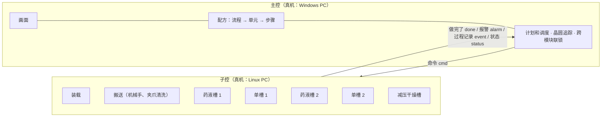

# 软件结构：主控规划、子控执行

作者介绍的真实设备分工（通用描述，2026-10-25）：主控 PC（Windows）负责画面、配方和调度；子控 PC（Linux）负责执行，例如搬送、各个槽。这个演示照这个分工写，三部分都在同一个网页里跑，但彼此只通过消息往来。

公开边界：这里只是通用的分工方式（设备行业常见的"上位规划、下位执行"），命令名、状态项都是原创的，不对应任何真实设备的协议。

## 1 · 谁做什么

| 部分 | 文件 | 做什么 | 不做什么 |
|---|---|---|---|
| 主控 | `sim/main.js` | 把配方排成整批的工艺步骤（计划）；按计划发命令、等"做完了"；记录晶圆在哪；交接之前用子控上报的状态查跨模块联锁（机械手在不在正上方、升降器到位没有、干燥槽的盖子开没开、夹爪干不干净）；收报警和过程记录给画面 | 不碰设备：要知道子控的情况，只看子控上报的状态 |
| 子控：装载 | `sim/subs.js` `LoaderSub` | FOUP 到位、开关门、映射、批量取片合批、姿态变换、分回 FOUP | |
| 子控：搬送 | `TransferSub` | 机械手移动、接片 / 放片（开合夹爪）、夹爪清洗干燥 | 不知道槽的状态：交接能不能做由主控判断 |
| 子控：各个槽 | `BathSub` | 自己的升降器；按主控发来的单元配方一步一步做；药液槽换液 | 不管别的槽 |
| 通信 | `sim/bus.js` | 送消息；子控的状态表 | |
| 机台本身 | `sim/tool.js` `Line` | 设备对象和物理：晶圆带出的液体混进下一个槽、在空气里的时间、表面的变化；把三部分接起来 | |

为什么这样分：主控管"整批怎么走"（要看全局：几个槽、机械手只有一台、晶圆在哪），子控管"这一个模块怎么动"（要快、要贴近硬件）。子控做完一个单元才回报，主控不用知道单元里每个阀什么时候开，这也是单元配方要下发给子控、由子控执行的原因。

## 2 · 消息

| 种类 | 方向 | 内容 |
|---|---|---|
| cmd | 主控 → 子控 | 做什么，带参数；执行单元时整个单元配方跟着发过去 |
| done | 子控 → 主控 | 某个命令做完了 |
| alarm | 子控 → 主控 | 报警（例如干燥槽：氧浓度没降下来就供 IPA） |
| event | 子控 → 主控 | 过程记录：单元里每一步的开始 / 结束、上流冲洗的结果、提示 |
| status | 子控 → 状态表 | 每个时间步更新：机械手位置、夹爪干不干净、升降器位置、盖子、忙不忙 |

命令一览：

| 子控 | 命令 |
|---|---|
| 装载 | `DOCK` FOUP 到位、`DOOR` 开 / 关门、`MAP` 映射、`TAKE` 取片、`POSTURE` 姿态变换、`RETURN` 分回 FOUP |
| 搬送 | `MOVE` 移动、`HOLD` 等待（模拟被别的任务占住）、`PICK` 接片、`PLACE` 放片、`CHUCK_CLEAN` 洗夹爪 |
| 槽 | `LIFT` 升降、`RUN_UNIT` 执行单元（带单元配方）、`EXCHANGE` 换液（药液槽） |

一个标准批大约 64 个命令。运行页下面的"主控 ↔ 子控"能看到子控忙不忙和最近的消息。

## 3 · 规矩（测试里检查，`sim/test/arch.test.js`）

- 主控不碰设备：测试里把主控能看到的机台换成一个代理，碰设备就报错，整批照样跑完
- 每个命令都有且只有一个"做完了"
- 消息是复制过去的：命令发出去以后再改主控这边的配方，正在执行的单元不受影响
- 晶圆追踪：每个工艺步骤做完，主控记录的位置和机台上真实的位置一致
- 子控的报警送到主控、主控记下来

## 4 · 和拆分之前一样吗

一样。消息立刻送到（延迟 0），子控在主控之前推进；拆分前后，9 个预置配方 × 2 种步长的全部结果（每一项的数值、统计、搬送时间）逐项比对，完全一致。

## 5 · 没做的（真机会有）

- 网络延迟、丢消息、重发；命令超时（子控一直不回，主控要报警）
- 子控自己的联锁（例如升降器下面有东西不能降）和硬件联锁
- 报警以后的处理：暂停、恢复、中止这一批
- 子控上报的状态有延迟：主控看到的是"刚才"的状态
- 多批同时在线（一批在药液槽、下一批在装载区）：调度要排机械手的时间，这是阶段 5 的吊车调度问题

## 修订记录

- 2026-10-25：初稿：主控 / 子控拆分，结果和拆分前一致
